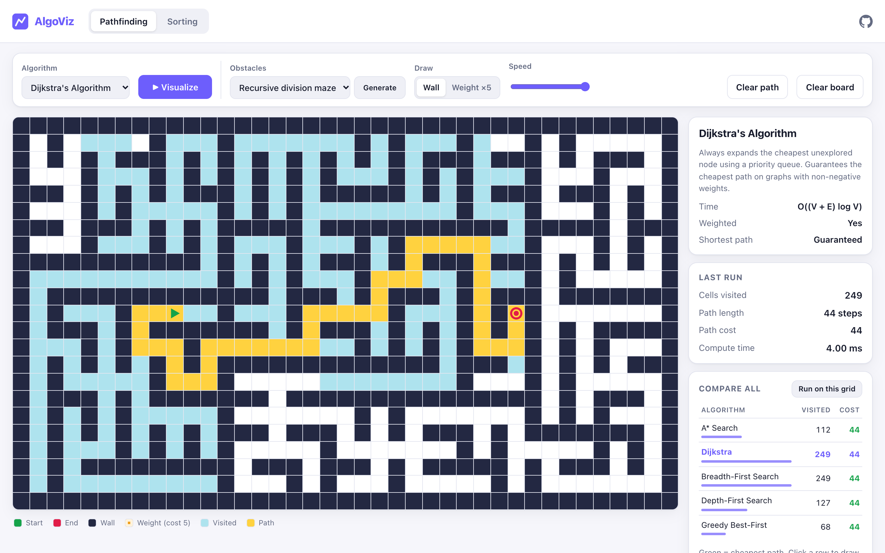
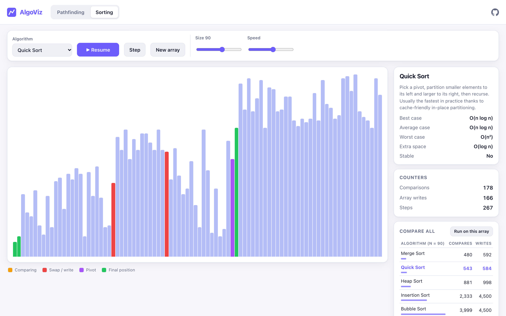

# AlgoViz: Pathfinding & Sorting Visualizer

[](https://github.com/pMag11-alt/algoviz/actions/workflows/ci.yml)


An interactive visualizer for classic graph-search and sorting algorithms. Draw walls and weighted cells, generate a
maze, then watch **A\***, **Dijkstra**, **BFS**, **DFS** and **Greedy Best-First** search it cell by cell. Or watch six sorting
algorithms rearrange an array and compare how much work each one does on the same input.

The app is written in vanilla JavaScript (ES modules) with **zero dependencies and no build step**. It has 113 unit tests
and deploys automatically to GitHub Pages.

**▶ Live demo: https://pmag11-alt.github.io/algoviz/**





## Features

**Pathfinding**
- 5 algorithms: A\*, Dijkstra, Breadth-First Search, Depth-First Search, Greedy Best-First
- Draw walls and **weighted cells** (cost 5) by clicking and dragging, with touch support
- Drag the start and end nodes. After a run, **the path re-computes live** as you edit the grid
- Obstacle generators: **recursive-division maze**, random walls, random weights
- **Compare all**: runs every algorithm on the current grid and compares cells visited and path cost.
  For example, A\* visits a fraction of the cells Dijkstra does for the same optimal cost, while BFS walks straight
  through expensive cells

**Sorting**
- 6 algorithms: Merge, Quick, Heap, Insertion, Selection and Bubble sort
- Play, pause, single-step, adjustable speed and array size (8–150)
- Live counters for comparisons and array writes
- Best, average and worst-case complexity, extra space, and stability for each algorithm
- **Compare all**: exact comparison and write counts for every algorithm on the same array

## Quick start

No install needed. Any static file server works.

```bash
git clone https://github.com/pMag11-alt/algoviz.git
cd algoviz
npm start            # → http://localhost:5173  (zero-dependency Node server)
```

No Node? Run `python3 -m http.server 5173` instead. The page has to be served over HTTP (not opened as a `file://`)
because browsers block ES-module imports from the file system.

```bash
npm test             # 113 unit tests, built-in node:test runner, no packages to install
```

## Algorithms

| Pathfinding         | Data structure     | Time              | Weighted | Shortest path |
|---------------------|--------------------|-------------------|:--------:|:-------------:|
| A\* Search           | Binary min-heap    | O((V + E) log V)  | ✅       | ✅            |
| Dijkstra            | Binary min-heap    | O((V + E) log V)  | ✅       | ✅            |
| Breadth-First Search | FIFO queue        | O(V + E)          | ❌       | ✅ (steps)    |
| Depth-First Search  | LIFO stack         | O(V + E)          | ❌       | ❌            |
| Greedy Best-First   | Binary min-heap    | O((V + E) log V)  | ✅       | ❌            |

| Sorting   | Best       | Average    | Worst      | Space    | Stable |
|-----------|------------|------------|------------|----------|:------:|
| Merge     | n log n    | n log n    | n log n    | n        | ✅     |
| Quick     | n log n    | n log n    | n²         | log n    | ❌     |
| Heap      | n log n    | n log n    | n log n    | 1        | ❌     |
| Insertion | n          | n²         | n²         | 1        | ✅     |
| Selection | n²         | n²         | n²         | 1        | ❌     |
| Bubble    | n          | n²         | n²         | 1        | ✅     |

## How it works

The project separates **pure algorithm code** from **DOM code**:

```
js/
├── lib/
│   ├── min-heap.js          # binary heap priority queue (used by Dijkstra / A* / Greedy)
│   ├── random.js            # seedable PRNG so mazes and tests are reproducible
│   └── dom.js               # tiny DOM + animation helpers
├── pathfinding/
│   ├── grid.js              # grid model: flat typed arrays, neighbours, Manhattan distance
│   ├── algorithms.js        # BFS, DFS, Dijkstra, A*, Greedy: pure functions
│   ├── mazes.js             # recursive division + random obstacles
│   └── view.js              # grid rendering, pointer editing, animation
├── sorting/
│   ├── algorithms.js        # six sorts written as generator functions
│   └── view.js              # bar rendering, playback controls, counters
└── main.js                  # tab routing (#pathfinding / #sorting)
tests/                       # node:test suites for every algorithm
```

Design decisions:

- **Search algorithms return a trace.** Each search returns the order it expanded cells plus the final path. The view
  replays that trace at any speed, and the same functions are unit-tested without a browser.
- **Sorting algorithms are generators.** Each sort `yield`s a step (`compare`, `swap`, `set`, `pivot`, `sorted`) after
  every operation. That makes play, pause and single-step easy to build, and the tests check that replaying the steps
  onto a copy of the input produces the sorted array.
- **One engine for three searches.** Dijkstra, A\* and Greedy share a best-first search loop and differ only in their
  priority function: `g`, `g + h` and `h`. A\* breaks ties on `h`, which makes it head toward the goal instead of
  spreading out evenly.
- **Typed arrays and flat ids.** Cells are addressed as `row * cols + col`, with walls, weights, distances and parents
  stored in `Uint8Array`, `Float64Array` and `Int32Array`. This avoids allocating thousands of small objects per search.
- **Lazy deletion in the heap.** Rather than implementing decrease-key, a node is pushed again when a cheaper route is
  found, and stale entries are skipped when popped.
- **Recursive division mazes.** Walls go on even coordinates and passages on odd ones. Each wall gets exactly one
  gap, so the result is a *perfect maze*. The tests check that every passage cell is reachable.

What the tests cover: every search returns a valid path (legal moves, no walls) or none when the end is walled off.
BFS is optimal on unweighted grids, and Dijkstra and A\* avoid expensive cells. On 40 random weighted grids, A\* always
matches Dijkstra's cost while expanding no more cells. Every sort handles empty, sorted, reversed and duplicate-heavy
inputs. Bubble and insertion sort run in linear time on sorted input, and selection sort always does exactly
n(n−1)/2 comparisons.

## Ideas for extension

- Bidirectional BFS and Jump Point Search
- Diagonal movement with the octile-distance heuristic
- Counting sort and radix sort, shown with a bucket view
- Sound effects keyed to bar height

## License

[MIT](LICENSE)
